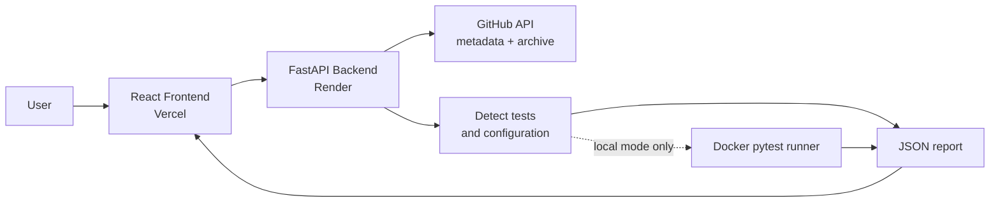
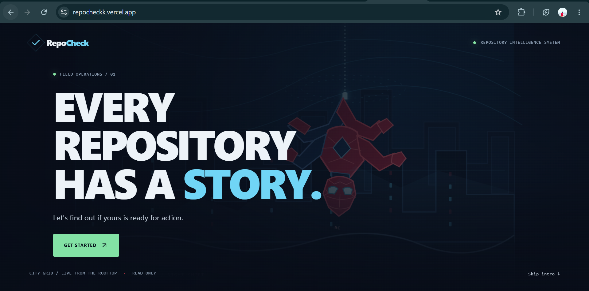
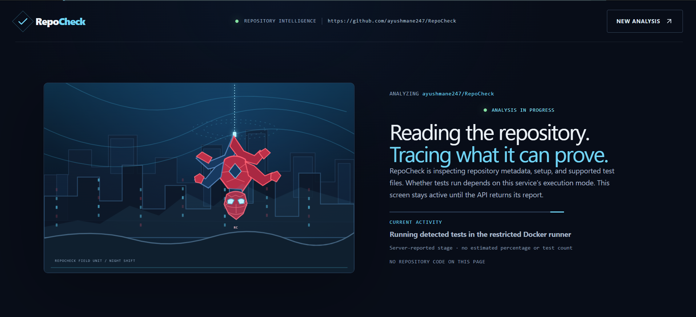
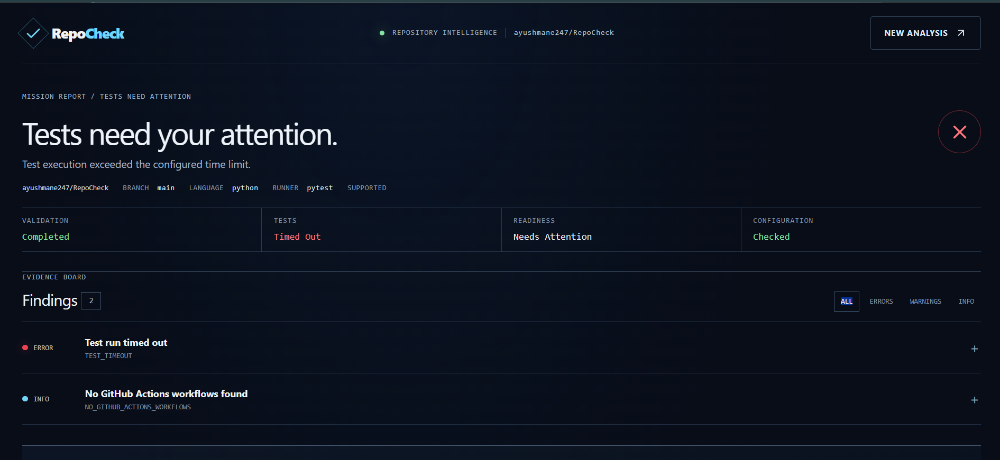
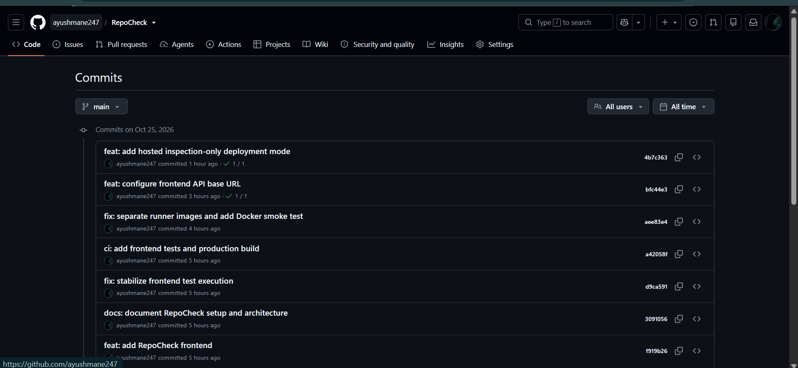
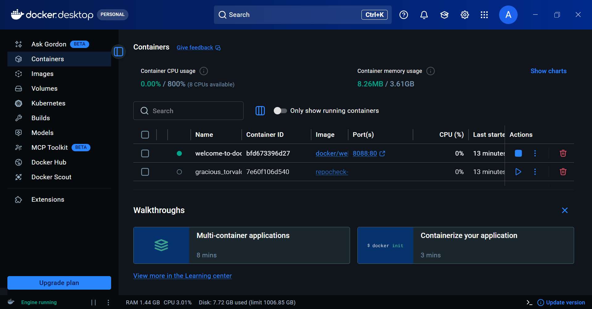
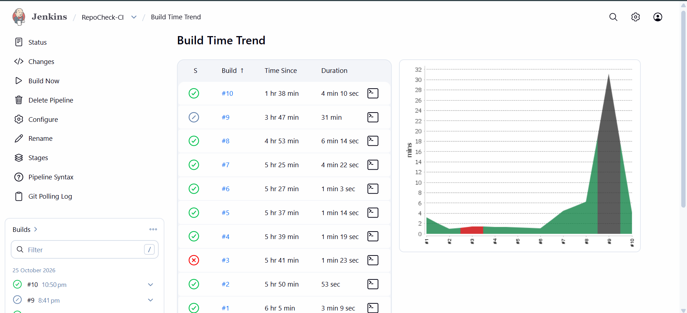
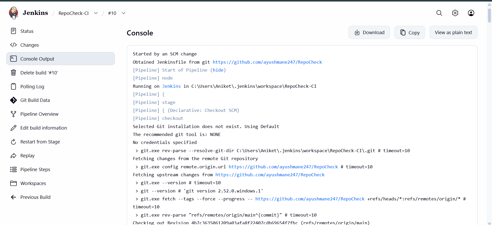

<h1 align="center">RepoCheck</h1> <p align="center"><b>Repository inspection and test verification for public GitHub projects.</b></p> <p align="center">      </p> <p align="center"> 

<br>

## Quick Links

- **GitHub Repository:** https://github.com/ayushmane247/RepoCheck
- **Live Website:** https://repocheckk.vercel.app/
- **API Documentation:** https://repocheck-api.onrender.com/docs
- **API Health Check:** https://repocheck-api.onrender.com/health
- **Commit History:** https://github.com/ayushmane247/RepoCheck/commits/main/

## Table of Contents

1. [Introduction and Objective](#1-introduction-and-objective)
2. [Features](#2-features)
3. [Technology Stack](#3-technology-stack)
4. [How to Run the Website](#4-how-to-run-the-website)
5. [Changes Made (Commit History)](#5-changes-made-commit-history)
6. [Git and GitHub Workflow](#6-git-and-github-workflow)
7. [Deployment](#7-deployment)
8. [DevOps Tool Integration: Jenkins](#8-devops-tool-integration-jenkins)
9. [Verification Results](#9-verification-results)
10. [Screenshots and Evidence](#10-screenshots-and-evidence)
11. [Limitations and Conclusion](#11-limitations-and-conclusion)

---

## 1. Introduction and Objective

RepoCheck is a web application that inspects a public GitHub repository and reports what can actually be verified about it: whether supported tests exist, which configuration files are present, and, when run locally, whether the tests pass.

**Core principle:** *Tests detected is not tests passed.* RepoCheck keeps inspection results separate from execution results, so a report never claims more than was verified.

**Objectives**

1. Build a working website (React frontend + FastAPI backend) in the domain of software verification.
2. Manage it with Git and GitHub using a clear history of meaningful commits.
3. Integrate a DevOps tool (**Jenkins**) to automate build and test checks.
4. Document the process with evidence in this README.

> **Note:** the public website runs in **inspection-only** mode and never executes submitted code. Real pytest execution is available through the local Docker runner.

---

## 2. Features

| Capability | Behavior |
|---|---|
| Input | Public GitHub repository URL |
| Inspection | Repository metadata; bounded, safely extracted source archive |
| Detection | Python test files (`test_*.py`, `*_test.py`) |
| Configuration checks | GitHub Actions workflows, pytest/tox/setup.cfg/pyproject syntax, dependency manifest presence |
| Local execution | Restricted Docker runner (no network, CPU/memory/process limits, read-only filesystem, dropped capabilities) |
| Result statuses | `passed`, `failed`, `collection_failed`, `timed_out`, `runner_error`, `no_tests`, `unsupported`, `not_run` |
| Report | Structured findings with evidence, limitations, and recommended actions |



---

## 3. Technology Stack

| Layer | Technology |
|---|---|
| Frontend | React, TypeScript, Vite, Tailwind CSS |
| Backend | Python 3.12, FastAPI, Uvicorn, HTTPX, PyYAML |
| Testing | pytest (backend), frontend test suite, Docker smoke test |
| Isolation | Docker |
| **DevOps tool** | **Jenkins** (pipeline defined in `Jenkinsfile`) |
| Version control | Git, GitHub |
| Hosting | Vercel (frontend), Render (backend) |

**Project structure**

```text
RepoCheck/
├── app/                 # FastAPI backend (inspection, detection, runner)
├── frontend/            # React + TypeScript + Vite website
├── runner-image/        # Dockerfile for the pytest runner
├── docker-integration/  # Docker smoke test
├── fixtures/            # Sample project used by the runner
├── tests/               # Backend tests
├── screenshots/         # Evidence images used in this README
├── Jenkinsfile          # Jenkins pipeline
├── render.yaml          # Render deployment config
└── requirements.txt
```

---

## 4. How to Run the Website

**Prerequisites:** Python 3.12, Node.js 20.19+, Git, and Docker Desktop (only for local test execution).

### Backend and production frontend

```powershell
git clone https://github.com/ayushmane247/RepoCheck.git
cd RepoCheck

python -m venv .venv
.\.venv\Scripts\Activate.ps1
python -m pip install -r requirements.txt

cd frontend
npm ci
npm run build
cd ..

uvicorn app.main:app --reload
```

Open **http://127.0.0.1:8000/** (website) or **http://127.0.0.1:8000/docs** (API docs).

### Frontend development mode

With the backend running, in a second terminal:

```powershell
cd frontend
npm ci
npm run dev
```

Open **http://127.0.0.1:5173/**. Vite proxies API calls to the backend.

### Local Docker test execution (optional)

```powershell
docker build -t repocheck-python-runner:dev -f runner-image/Dockerfile runner-image
```

Local runs use `local_docker` mode by default. The hosted service sets `REPOCHECK_EXECUTION_MODE=inspection_only`.

---

## 5. Changes Made (Commit History)

Repository: https://github.com/ayushmane247/RepoCheck | Branch: `main` | Total commits: 14

### Five key changes

| # | Commit | Message | What it did |
|---|---|---|---|
| 1 | [`f919b26`](https://github.com/ayushmane247/RepoCheck/commit/f919b265bef9886322c4c573351c7da9ada0e00c) | `feat: add RepoCheck frontend` | Added the React + TypeScript website on top of the API |
| 2 | [`a42058f`](https://github.com/ayushmane247/RepoCheck/commit/a42058f0d70498f29432929a1b8b0c84497fc322) | `ci: add frontend tests and production build` | Jenkins now tests and builds the frontend |
| 3 | [`aee83e4`](https://github.com/ayushmane247/RepoCheck/commit/aee83e42029cbf3d3eb4010ccbea350de36f329d) | `fix: separate runner images and add Docker smoke test` | Split the source runner from the fixture image; added a real Docker integration test |
| 4 | [`bfc44e3`](https://github.com/ayushmane247/RepoCheck/commit/bfc44e36c46007440aac5e0ce6af4dcbfbbcaa02) | `feat: configure frontend API base URL` | Frontend can call the hosted API through `VITE_API_BASE_URL` |
| 5 | [`4b7c363`](https://github.com/ayushmane247/RepoCheck/commit/4b7c3635061209a03afa8f22407cdb69654f7fbc) | `feat: add hosted inspection-only deployment mode` | Hosted site reports `not_run` and never executes submitted code |

<!-- TODO: add any further website/UI commits here, with a before/after screenshot for each. -->

### Complete commit log

| Commit | Message |
|---|---|
| [`911a881`](https://github.com/ayushmane247/RepoCheck/commit/911a8818898eb1d6e3da153e4fb5193b18e15101) | chore: initialize RepoCheck API |
| [`8492f4f`](https://github.com/ayushmane247/RepoCheck/commit/8492f4f551ebf700a5a9691bbc28e5533bee48b8) | feat: add isolated Docker test runner |
| [`9d14b80`](https://github.com/ayushmane247/RepoCheck/commit/9d14b80957942559795be7f6809bb1c8ee2b225d) | feat: add GitHub repository inspection |
| [`3541fdb`](https://github.com/ayushmane247/RepoCheck/commit/3541fdb5f972585c2937424c5659b47c189e8836) | ci: add initial Jenkins pipeline |
| [`e07468a`](https://github.com/ayushmane247/RepoCheck/commit/e07468a15b2acb8a21edaabff1a0c29389d0b22b) | feat: add safe repository archive handling |
| [`26b3500`](https://github.com/ayushmane247/RepoCheck/commit/26b3500d443d8c8a36f71200734c40b5cfafb5d0) | feat: inspect repository tests and configuration |
| [`68515f7`](https://github.com/ayushmane247/RepoCheck/commit/68515f75433ec53a8c7006df8495d2d79564cb7b) | feat: integrate repository validation pipeline |
| [`f919b26`](https://github.com/ayushmane247/RepoCheck/commit/f919b265bef9886322c4c573351c7da9ada0e00c) | feat: add RepoCheck frontend |
| [`3091056`](https://github.com/ayushmane247/RepoCheck/commit/3091056e647e9b11c8bac8055fd189702d2b5f9e) | docs: document RepoCheck setup and architecture |
| [`d9ca591`](https://github.com/ayushmane247/RepoCheck/commit/d9ca591862dd9153e0cf02f09897619bdab31282) | fix: stabilize frontend test execution |
| [`a42058f`](https://github.com/ayushmane247/RepoCheck/commit/a42058f0d70498f29432929a1b8b0c84497fc322) | ci: add frontend tests and production build |
| [`aee83e4`](https://github.com/ayushmane247/RepoCheck/commit/aee83e42029cbf3d3eb4010ccbea350de36f329d) | fix: separate runner images and add Docker smoke test |
| [`bfc44e3`](https://github.com/ayushmane247/RepoCheck/commit/bfc44e36c46007440aac5e0ce6af4dcbfbbcaa02) | feat: configure frontend API base URL |
| [`4b7c363`](https://github.com/ayushmane247/RepoCheck/commit/4b7c3635061209a03afa8f22407cdb69654f7fbc) | feat: add hosted inspection-only deployment mode |

---

## 6. Git and GitHub Workflow

```powershell
git init                                   # create the repository
git remote add origin https://github.com/ayushmane247/RepoCheck.git
git status                                 # check the working tree
git diff                                   # review changes
git add <files>                            # stage selected files
git commit -m "feat: short description"    # commit with a meaningful message
git push origin main                       # publish to GitHub
git log --oneline --decorate               # review history
```

**Conventions:** one logical change per commit, using Conventional Commit prefixes: `feat`, `fix`, `ci`, `docs`, `chore`.

---

## 7. Deployment

| Component | Platform | URL |
|---|---|---|
| Frontend | Vercel | https://repocheckk.vercel.app/ |
| Backend API | Render | https://repocheck-api.onrender.com/ |
| API docs | Render | https://repocheck-api.onrender.com/docs |

- The backend is configured by `render.yaml` and runs with `REPOCHECK_EXECUTION_MODE=inspection_only`.
- The frontend reads the backend address from `VITE_API_BASE_URL`, set in the Vercel project settings.
- The Render free tier may take extra time to respond after inactivity.

---

## 8. DevOps Tool Integration: Jenkins

**Why Jenkins:** it runs the same build and test steps automatically on every build, so regressions are caught early and results are repeatable.

The pipeline is defined as code in [`Jenkinsfile`](Jenkinsfile), added in `3541fdb` and extended with frontend tests and build in `a42058f`.

<!-- TODO: replace this table with the exact stage names from your Jenkinsfile. -->
| Stage | What it does |
|---|---|
| Checkout | Pulls the latest code from GitHub |
| Backend tests | `python -m pytest -q` |
| Frontend | `npm ci`, `npm test`, `npm run typecheck`, `npm run build` |
| Docker runner | Builds `repocheck-python-runner:dev` and runs `docker-integration/runner_smoke.py` |

### Integration steps

1. Install and start Jenkins (`http://localhost:8080/`).
2. Install the **Pipeline** and **Git** plugins.
3. Make sure the Jenkins agent has Python 3.12, Node.js, and access to Docker.
4. Create a new **Pipeline** job named `RepoCheck-CI`.
5. Under *Pipeline*, choose **Pipeline script from SCM**, set SCM to **Git**, and enter `https://github.com/ayushmane247/RepoCheck.git`.
6. Set the branch to `*/main` and Script Path to `Jenkinsfile`.
7. Save, then click **Build Now**.
8. Open the build and review **Console Output** and the stage results.

### Result

| Item | Value |
|---|---|
| Job | `RepoCheck-CI` |
| Build number | **TODO** |
| Result | **TODO** (SUCCESS / FAILURE) |

---

## 9. Verification Results

| Check | Command | Result |
|---|---|---|
| Backend tests | `python -m pytest -q` | TODO |
| Frontend tests | `npm test` | TODO |
| Type check | `npm run typecheck` | TODO |
| Production build | `npm run build` | TODO |
| Docker smoke test | `python -m pytest -q docker-integration/runner_smoke.py` | TODO |

---

## 10. Screenshots and Evidence

All images are in the [`screenshots/`](screenshots/) folder.

### A. Website


*Fig 1. Landing page of the RepoCheck website.*


*Fig 2. A public GitHub repository URL submitted for inspection.*


*Fig 3. Inspection report showing metadata, detected tests, findings, and the `not_run` status in hosted mode.*

### B. Git and GitHub


*Fig 4. GitHub repository with the project files.*


*Fig 5. Commit history on `main`.*

### C. Docker runner


*Fig 6. Local pytest execution through the restricted Docker runner.*

### D. Jenkins


*Fig 7. `RepoCheck-CI` pipeline job configured from SCM.*


*Fig 8. Jenkins build stages and console output with the actual result.*

<!-- TODO: add before/after screenshots for any additional website changes, e.g. screenshots/change-1-before.png and change-1-after.png -->

---
reporting, more languages and frameworks, and a refined mobile interface.

**Conclusion:** RepoCheck combines a React frontend, a FastAPI backend, Docker-based isolation, Git/GitHub version control, and a Jenkins CI pipeline. It reports only what has actually been verified, and it keeps inspection separate from execution.
